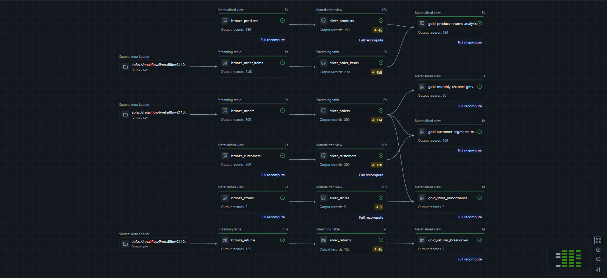
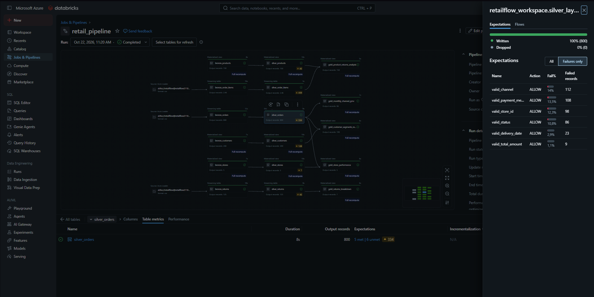
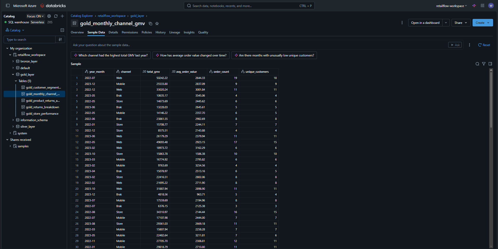
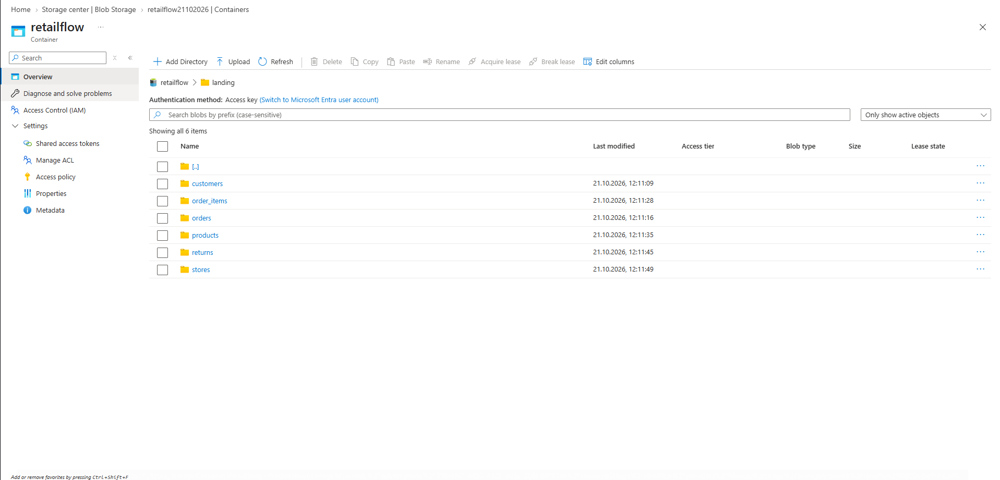

# RetailFlow – E-Commerce Data Pipeline (Azure Databricks & Spark Declarative Pipelines)

Projekt potoku danych zbudowany w architekturze **Medallion (Bronze → Silver → Gold)** na platformie **Azure Databricks**. Głównym celem było zamodelowanie realnego przepływu danych dla firmy e-commerce/retail: od wczytania „brudnych” plików CSV z chmury Azure, przez automatyczne czyszczenie i walidację jakości danych, aż po gotowe tabele analityczne (Data Marts) odpowiadające na konkretne pytania biznesowe.

Całość została napisana z użyciem **Spark Declarative Pipelines (`pyspark.pipelines`)** i osadzona w **Unity Catalog**.

---

## O co chodzi w projekcie? (Kontekst biznesowy)

Dane spływają do data lake (ADLS Gen2) z 4 różnych systemów: CRM (`customers`), ERP (`products`), systemu zamówień (`orders`, `order_items`, `stores`) oraz systemu zwrotów (`returns`). 

Jak to często bywa w danych produkcyjnych, pliki źródłowe zawierały sporo błędów:
* różne formaty zapisu dat w jednej kolumnie (np. `yyyy-MM-dd`, `dd.MM.yyyy`, `MM/dd/yyyy`),
* błędne wartości liczbowe (ujemne ceny, wartości zastępcze typu `999999`),
* brakujące klucze główne i puste stringi udające wartości (`"null"`, `"nan"`, `""`),
* anomalie logiczne (np. data dostawy wcześniejsza niż data zamówienia).

Zamiast czyścić to ręcznie w notebookach, zbudowałem deklaratywny pipeline, który sam wychwytuje błędy, raportuje metryki jakości danych i przepuszcza do warstwy analitycznej tylko zweryfikowane rekordy.

---

## Pytania biznesowe, na które odpowiada pipeline

Warstwa Gold oraz metryki potoku zostały zaprojektowane tak, aby dostarczyć bezpośrednich odpowiedzi na 6 pytań biznesowych:

1. **Jak wygląda sprzedaż (GMV i średni koszyk) per kanał i miesiąc?**
   * Tabela: `gold_monthly_channel_gmv` – miesięczne podsumowanie przychodu (`total_gmv`), średniej wartości zamówienia (`avg_order_value`), liczby zamówień oraz unikalnych klientów w podziale na kanały (`Web`, `Mobile`, `Store`).
2. **Którzy klienci generują największy przychód?**
   * Tabela: `gold_customer_segments_revenue` – wyliczenie wartości życiowej klienta (CLV), liczby zamówień oraz daty pierwszego i ostatniego zakupu w podziale na segmenty (`VIP`, `Regular`, `New`).
3. **Które produkty są najczęściej zwracane i jak wypadają na tle swojej kategorii?**
   * Tabela: `gold_product_returns_analysis` – zestawienie sprzedanych i zwróconych sztuk wraz ze stopą zwrotów produktu (`product_return_rate_pct`) porównaną ze średnią stopą zwrotów dla całej kategorii (policzone funkcją okna `Window.partitionBy`).
4. **Ile rekordów odpada lub zawiera błędy na etapie czyszczenia danych?**
   * Mechanizm: Reguły **Expectations** (`@dp.expect_or_drop`, `@dp.expect_all`) w warstwie Silver – potok na bieżąco zlicza i pokazuje w interfejsie Databricks odsetek niepoprawnych rekordów dla każdej reguły.
5. **Jak wypada sprzedaż w sklepach stacjonarnych w porównaniu do kanału Online?**
   * Tabela: `gold_store_performance` – ranking placówek stacjonarnych oraz sklepu internetowego pod kątem wygenerowanego przychodu i procentowego udziału w całej sprzedaży (`revenue_share_pct`).
6. **Dlaczego klienci zwracają towar i ile to kosztuje firmę?**
   * Tabela: `gold_returns_breakdown` – podział zwrotów według przyczyn (`reason`), ich udział procentowy we wszystkich reklamacjach oraz łączna i średnia kwota refundacji.

---

## Co siedzi pod maską? (Architektura i kod)

### 1. Infrastruktura i połączenie z chmurą (`infra/`)
* Surowe pliki leżą na koncie **Azure Data Lake Storage Gen2** w kontenerze `retailflow/landing/`.
* Dostęp z Databricks do ADLS Gen2 skonfigurowałem bez używania kluczy dostępowych w kodzie – przez **Azure Access Connector (Managed Identity)**, **Storage Credential** oraz **External Location** w Unity Catalog.
* Wszystkie tabele wynikowe zapisywane są jako tabele zarządzane (**Managed Tables**) w katalogu `retailflow_workspace` z podziałem na schematy `bronze_layer`, `silver_layer` i `gold_layer`.

### 2. Warstwa Bronze (`src/bronze_layer.py`)
* Tabele transakcyjne (`orders`, `order_items`, `returns`) ładowane są przyrostowo jako **Streaming Tables** za pomocą **Auto Loadera (`cloudFiles`)** z dodaniem kolumny `ingested_at`.
* Tabele słownikowe (`customers`, `products`, `stores`) wczytywane są jako **Materialized Views**.

### 3. Warstwa Silver (`src/silver_layer.py`)
Tutaj dzieje się całe czyszczenie danych i wymuszanie typów:
* Napisałem funkcje pomocnicze w PySparku do czyszczenia pustych stringów (`clean_empty_strings`), parsowania wieloformatowych dat (`parse_date` oparte na `coalesce` i `try_to_date`) oraz ujednolicania wartości logicznych (`parse_boolean`).
* **Standaryzacja danych:** formatowanie polskich numerów telefonów do postaci `+48XXXXXXXXX`, walidacja e-maili regexem, ujednolicenie wielkości liter w nazwach miast, marek, kategorii i metod płatności, korekta ujemnych kwot (`abs`) i wycięcie outlierów (`999999`).
* **Logika biznesowa:** zamówienia z kanałów `Web` i `Mobile`, które miały brakujący lub błędny `store_id` (`999`), są automatycznie przepinane pod sklep internetowy (`store_id = 105`).
* **Kontrola jakości (Data Quality):** rekordy bez klucza głównego są odrzucane (`@dp.expect_or_drop`), a naruszenia reguł biznesowych (np. `delivery_date < order_date`, rabat powyżej 50%, błędny format telefonu) są oznaczane i logowane w metrykach potoku (`@dp.expect_all`).

### 4. Warstwa Gold (`src/gold_layer.py`)
* Zestaw 5 zmaterializowanych widoków (`@dp.materialized_view`) zasilanych czystymi danymi z warstwy Silver.

---

## Decyzje projektowe (Dlaczego tak to rozwiązałem?)

* **Kiedy Streaming Tables, a kiedy Materialized Views:** Tabele z transakcjami (`orders`, `order_items`, `returns`) cały czas rosną, dlatego w warstwach Bronze i Silver użyłem *Streaming Tables* oraz Auto Loadera (`cloudFiles`). Dzięki temu przy kolejnych uruchomieniach potok dogrywa tylko nowe pliki z Azure, zamiast za każdym razem mielić całą historię od nowa. Z kolei mniejsze tabele słownikowe (`customers`, `products`, `stores`) i raporty w warstwie Gold zrobiłem jako *Materialized Views*, bo wymagają przeliczenia całości (np. grupowania i funkcji okna), o co Databricks dba już automatycznie.
* **Odrzucanie rekordów (`expect_or_drop`) vs. samo logowanie błędów (`expect_all`):** Wiersze bez klucza głównego (np. brak `order_id` czy `customer_id`) od razu wyrzucam z potoku za pomocą `@dp.expect_or_drop`, bo i tak nie da się ich z niczym połączyć w `JOIN`-ach i psułyby wyniki. Natomiast błędy w pojedynczych kolumnach (np. brak telefonu, dziwna data dostawy czy za duży rabat) sprawdzam przez `@dp.expect_all`. Zamiast usuwać cały wiersz, zamieniam tylko błędną wartość na `NULL` i puszczam rekord dalej. Gdybym wyrzucał całe zamówienie przez zły format maila albo brak numeru telefonu, sztucznie zaniżyłbym przychody (GMV) w warstwie Gold.
* **Naprawa danych tam, gdzie to możliwe, zamiast ich usuwania:** W zamówieniach z kanałów `Web` i `Mobile` często pojawiał się nieistniejący sklep (`store_id = 999`) albo puste pole. Zamiast traktować te zamówienia jako błędne, dodałem w warstwie Silver prostą regułę, która przypisuje je do sklepu internetowego (`store_id = 105`). Dzięki temu zachowałem pełną sprzedaż online i poprawne powiązanie z tabelą sklepów.
* **Tabele zarządzane (Managed Tables) w Unity Catalog:** Surowe pliki CSV wpadają na moje konto ADLS Gen2 (podpięte bezpiecznie przez *External Location* i *Managed Identity*, bez wpisywania kluczy w kodzie), ale gotowe tabele w Bronze, Silver i Gold zostawiłem jako *Managed Tables* w Unity Catalog (`retailflow_workspace`). Nie musiałem przez to ręcznie zarządzać folderami pod pliki Parquet na Azure, a Databricks sam pilnuje porządku w plikach i optymalizacji tabel.

---

## Zrzuty ekranu z działającego projektu

### Graf potoku (Spark Declarative Pipelines)


### Metryki jakości danych (Data Quality Expectations na tabeli `silver_orders`)


### Przykładowa tabela wynikowa w warstwie Gold (`gold_monthly_channel_gmv`)


### Struktura plików źródłowych w kontenerze ADLS Gen2


---

## Struktura repozytorium

```text
retailflow-databricks-pipeline/
├── src/
│   ├── bronze_layer.py          # Ingestia danych z ADLS Gen2 (Auto Loader & CSV)
│   ├── silver_layer.py          # Czyszczenie, transformacje i reguły Data Quality
│   └── gold_layer.py            # Agregacje biznesowe i tabele analityczne
├── infra/
│   ├── azure_template.json      # Wyeksportowany szablon ARM z zasobami Azure
│   └── pipeline_settings.json   # Konfiguracja potoku z Databricks
├── docs/
│   └── images/                  # Zrzuty ekranu z wykonania potoku i Azure Portal
└── README.md
```

---
